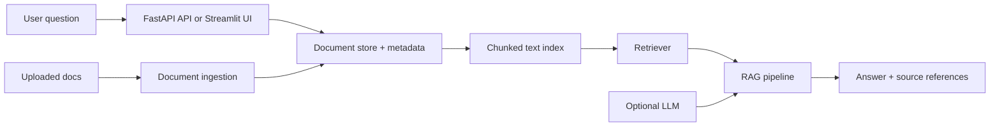

# University Assistant

University Assistant is a local, document-grounded assistant for university questions. It ingests academic documents such as PDFs, DOCX files, TXT files, and CSV files, splits the content into searchable chunks, retrieves the most relevant content, and answers questions using the available evidence only.

This project is designed for a safe local demo workflow. It does not fabricate facts or pretend that an LLM is being used when no real model is configured. If the system cannot find evidence in the available documents, it clearly states that the information is not available in the current sources.

## Project Overview

The system helps students ask questions like:

- What are the admission requirements?
- What documents are required for application?
- What are the tuition fees mentioned in the university documents?
- What are the rules for attendance and exams?
- What are the course requirements for a specific program?

The assistant is intentionally conservative: every answer is grounded in retrieved document content and references the source file and page when available.

## Problem Statement

Most universities distribute important information across PDFs, Word documents, and regulations pages. Students often need a quick but reliable way to search these sources without reading hundreds of pages manually. A retrieval-augmented assistant can help, but it must remain grounded in the actual documents and avoid inventing facts or making unsupported claims.

## Features

- Local document ingestion for PDF, DOCX, TXT, and CSV
- Safe validation of file type and file size
- Text extraction with PDF page metadata when available
- Chunking for semantic retrieval
- Local retrieval using embeddings with a safe fallback mode
- Demo mode when no LLM is configured
- Source-backed answer generation
- FastAPI endpoints for chat and document management
- Streamlit UI for a simple local interaction flow
- MongoDB compatibility with a clear fallback to an in-memory repository
- Test suite covering the core behaviors

## Architecture



## Tech Stack

- Python 3.11+
- FastAPI
- Streamlit
- Pydantic
- SentenceTransformers
- PyMuPDF
- python-docx
- pandas
- pytest
- python-dotenv
- MongoDB-ready layer with safe fallback

## Project Structure

```text
University_Assistant/
├── app/
│   ├── api/
│   │   └── routes.py
│   ├── core/
│   │   ├── document_loader.py
│   │   ├── embeddings.py
│   │   ├── llm_provider.py
│   │   ├── retriever.py
│   │   └── text_chunker.py
│   ├── database/
│   │   ├── mongo_client.py
│   │   └── repositories.py
│   ├── models/
│   │   └── schemas.py
│   ├── services/
│   │   ├── chat_service.py
│   │   └── document_service.py
│   ├── ui/
│   │   └── streamlit_app.py
│   ├── __init__.py
│   ├── config.py
│   ├── main.py
│   └── rag_pipeline.py
├── data/
│   ├── processed/
│   ├── sample_documents/
│   └── uploads/
├── scripts/
│   └── ingest_documents.py
├── tests/
│   ├── test_api.py
│   ├── test_document_loader.py
│   ├── test_rag_pipeline.py
│   ├── test_retriever.py
│   └── test_text_chunker.py
├── .env.example
├── .gitignore
├── LICENSE
├── pytest.ini
├── README.md
├── requirements.txt
├── SCREENSHOTS.md
└── ...
```

## Installation

1. Clone the repository.
2. Create and activate a virtual environment:

```bash
python -m venv .venv
# Windows
.venv\Scripts\activate
# Linux/macOS
source .venv/bin/activate
```

3. Install dependencies:

```bash
pip install -r requirements.txt
```

4. Copy the environment example:

```bash
copy .env.example .env
```

5. Review the environment variables before running the app.

## Environment Variables

The project uses a local `.env` file. Example values are in `.env.example`.

Important settings:

- `APP_NAME`
- `APP_ENV`
- `API_HOST`
- `API_PORT`
- `STREAMLIT_PORT`
- `MONGODB_URI`
- `MONGODB_DB`
- `LLM_PROVIDER`
- `LLM_API_KEY`
- `LLM_MODEL`
- `EMBEDDING_MODEL`
- `MAX_RETRIEVED_CHUNKS`
- `MIN_RELEVANCE_SCORE`
- `MAX_UPLOAD_SIZE_MB`
- `ALLOWED_EXTENSIONS`

No secrets should be committed to the repository.

## Running the Application

### FastAPI API

```bash
uvicorn app.main:app --reload --host 0.0.0.0 --port 8000
```

### Streamlit UI

```bash
streamlit run app/ui/streamlit_app.py --server.port 8501
```

### Document ingestion from a folder

```bash
python scripts/ingest_documents.py data/uploads
```

## Adding University Documents

1. Place the files into the `data/uploads` directory.
2. In the Streamlit UI, upload documents or use the re-index button.
3. Or run the CLI ingest command shown above.
4. Ensure the text is actually readable. If a PDF contains only scanned images and no selectable text, the app will show a warning instead of pretending OCR was performed.

The files in `data/sample_documents` are bilingual summaries based on linked Cairo University pages. They are indexed automatically on the first chat request. Admission requirements are faculty-specific, and current dates or fees should be checked against the linked official page. The assistant answers in the language of the question and avoids guessing when the indexed sources do not cover the topic.

## API Endpoints

- `GET /health`
- `POST /chat`
- `POST /documents/upload`
- `GET /documents`
- `POST /documents/ingest`
- `DELETE /documents/{document_id}`

Example chat request:

```json
{
  "question": "What are the admission requirements?"
}
```

Example response:

```json
{
  "answer": "Based on the available documents, the admission requirements include ...",
  "sources": [
    {
      "document_id": "abc",
      "file_name": "Admission_Guide.pdf",
      "page_number": 4
    }
  ]
}
```

## RAG Workflow

The workflow is intentionally conservative:

1. The user asks a question.
2. The question is cleaned and normalized.
3. The system searches the stored document chunks.
4. The highest-scoring relevant chunks are selected.
5. The retrieved chunks are passed to a generation step only when an actual LLM is configured.
6. If no reliable evidence is found, the assistant says the information is not available in the current documents.
7. Source references are attached to the answer when available.

## Evaluation and Limitations

This project does not claim benchmark scores or production-quality accuracy. The current implementation is a local demonstration and research scaffold. It is best used with university documents that are readable and trustworthy.

Important limitations:

- It is not a substitute for official university policies.
- It does not OCR scanned PDFs unless OCR is implemented and verified separately.
- The local embedding fallback is lightweight and intentionally simple.
- The app does not fabricate missing facts.
- Quantitative evaluation has not been performed yet.

## Security and Privacy

- Secrets are not stored in source files.
- Use `.env` for environment variables and do not commit it.
- Validate file extension and maximum upload size.
- Do not allow arbitrary document execution or system changes.
- Treat all document content as untrusted input.
- MongoDB credentials and API keys should never be logged.

## Testing

Run the tests with:

```bash
pytest
```

The test suite covers:

- Text extraction from a sample document
- Empty file handling
- Chunk creation and metadata retention
- Retrieval relevance checks
- No-answer behavior when evidence is absent
- No-LLM fallback handling
- API success and validation checks
- Import safety and source linkage

## Screenshots

No screenshots are included in this repository because none were captured. For a future portfolio update, instructions are provided in `SCREENSHOTS.md`.

## Future Improvements

- Add a stronger embedding model with a local cache strategy
- Add a formal document evaluation workflow
- Add support for authentic LLM providers with explicit safety controls
- Add a proper MongoDB collection schema
- Add authentication and authorization for production deployments
- Add analytics and error logging with secret filtering

## License

This project is licensed under the MIT License. See the `LICENSE` file for details.
